# 👋 Salut, je suis Malang Coulibaly

### Développeur Fullstack · Ingénieur Systèmes & Réseaux · DevOps

📍 Dakar, Sénégal

  

<h3><code>malang@github ~ $ ./contributions.sh</code></h3>

  

<h3><code>malang@github ~ $ whoami</code></h3>
<table>
  <tr>
    <td valign="top"></td>
    <td valign="top"></td>
  </tr>
</table>

---

## 🧑‍💻 À propos

- 💼 **DevOps & Fullstack Engineer** chez **Tiak-Tiak × Talent 2 Africa**
- 🚀 Plus de 3 ans d'expérience en développement web et en gestion d'infrastructures IT
- ⚙️ Spécialisé en **backend Go**, **architecture cloud** et **pipelines CI/CD**
- 🎓 Master Systèmes & Réseaux — Université Alioune Diop de Bambey
- 🏫 Formé à **Zone01 Dakar** (alternance chez **Atos Sénégal**)
- 🌱 Passionné par l'open source, l'IA, l'IoT et les technologies émergentes

---

## 🛠️ Stack technique

**Langages**

**Frameworks & Mobile**

**DevOps, Cloud & Systèmes**

---

## 🚀 Projets phares

| Projet | Description | Stack |
|---|---|---|
| 📸 **Réseau social type Instagram** | Authentification JWT, indexation PostgreSQL avancée (−45 % de temps de requête), 1000+ utilisateurs simultanés | Go · React · PostgreSQL · Docker |
| 🎮 **Jeux multijoueurs temps réel** | Architecture client/serveur WebSocket, gestion de sessions et reconnexion auto, 100+ joueurs, latence < 50 ms | Go · WebSocket |
| 🏥 **Plateformes SaaS (santé & divertissement)** | API REST scalables, multi-utilisateurs avec gestion des rôles, déploiement cloud avec monitoring | REST · AWS · CI/CD |

👉 Plus de détails sur mon **[portfolio](https://malang27.github.io/)**

---

## 💼 Expérience

- **DevOps & Fullstack Engineer** — Tiak-Tiak × Talent 2 Africa *(oct. 2026 – aujourd'hui)*
- **Développeur Fullstack (alternance)** — Zone01 Dakar / Atos Sénégal *(sept. 2023 – avr. 2026)* 
  5+ applications web, API REST sécurisées pour 3 projets SaaS, déploiements 40 % plus rapides, disponibilité 99,9 %
- **Administrateur Systèmes & Réseaux (stage)** — Hôpital Albert Royer, Dakar *(juin – juil. 2023)*

---

📫 **Me contacter :** [mvlang27@gmail.com](mailto:mvlang27@gmail.com) · [LinkedIn](https://www.linkedin.com/in/malang-coulibaly-33a846181) · [Portfolio](https://malang27.github.io/)

